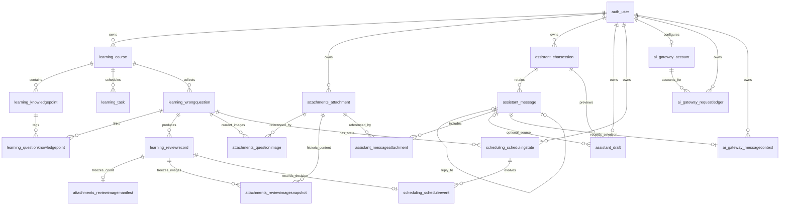

# 数据库课程说明

当前结构以源码模型/迁移为准：19业务表+9框架支持表=28，InnoDB/utf8mb4，15个触发器。以下关系、约束和事务说明已与当前代码核对。初始化以迁移为准；结构SQL无用户行，不向已有库导入。

[生成的字段字典](数据库数据字典.md)包含每字段类型/可空/外键、约束、索引；课程组员、日期与教师邮箱由小组自行填写，GitHub发布不代提交作业。

## 2. 表的职责与数据字典摘要

六张旧表仍是业务核心：`learning_course`、`learning_knowledgepoint`、`learning_task`、`learning_wrongquestion`、`learning_questionknowledgepoint`、`learning_reviewrecord`。课程关联用户，任务和错题通过课程确定归属；知识点与错题采用显式中间表；复习记录保存当时题目、答案、错因、课程及知识点名称的文本/JSON 快照。

V2 新增表如下。UUID 在当前 MySQL/Django 组合中采用字符形式保存；BIGINT 用于普通自增业务标识，DATETIME 保存 UTC 时间，DATE 表示上海自然日。JSON 用于受校验的结构化状态与快照，不存放可执行脚本。

| 应用 / 实际表名 | 主要字段与关系 | 用途 |
| --- | --- | --- |
| `attachments_attachment` | UUID 主键；owner、storage_key、sha256、width/height、byte_size、thumbnail_bytes | 不可变图片目录记录；图片字节在私有文件目录，不作为 BLOB 塞入数据库 |
| `attachments_questionimage` | question、attachment 外键；role、position | 当前错题图片，区分题干、原答、参考答案、错因四种用途，可调整当前关联 |
| `attachments_reviewimagemanifest` | review 外键同时为主键；image_count | 冻结某次复习的图片数量；零张也形成清单 |
| `attachments_reviewimagesnapshot` | review、attachment 外键；用途、顺序、名称/尺寸/哈希快照 | 历史图片关联，编辑当前题目不会替换旧复习图片 |
| `assistant_chatsession` | UUID 主键；owner、title、submission_key、created_at/updated_at | 持久会话与会话列表 |
| `assistant_message` | UUID 主键；session、role、text、status、submission_key、request_hash、reply_to | 本地用户消息、助手回复或明确的系统提示；reply_to 为可空一对一关联 |
| `assistant_messageattachment` | message、attachment 外键；position | 图文消息的图片关联，复用图片目录记录 |
| `assistant_draft` | UUID 主键；owner/session/source_message、operation、payload、前后快照、target_id、expected_version、状态/确认标识/到期时间 | 对单一指定对象的待确认修改，先预览再保存 |
| `scheduling_schedulingstate` | user、question 外键；card_state、algorithm/version、config_snapshot/version、revision | 每个用户与题目的 FSRS 当前状态 |
| `scheduling_scheduleevent` | state 外键；review_record 一对一；前后状态、修订号、算法配置、due_utc、suggested_date/applied_date、manual_override_date | 不可变调度事件，与真实复习历史相对应 |
| `ai_gateway_account` | owner 一对一；budget/spent/reserved 的 DECIMAL(14,6)、revision、enabled、consent_at、key_reference | 每用户预算与人工启用记录；数据库只保存随机密钥引用，不存 API key |
| `ai_gateway_requestledger` | UUID 主键；request_id 唯一；owner/account、request_hash、状态与发送标记、价格快照、token 上限、费用与额度 | 请求预留、发送和结算账本；不保存题目、图片或回复正文 |
| `ai_gateway_messagecontext` | message 外键同时为主键；owner、selected_history_ids、目标/课程快照、expected_version | 记录用户主动选定的本次上下文范围，签名保留在本地 |

来源：[旧模型](../learning/models.py)、[图片模型](../attachments/models.py)、[会话与草稿模型](../assistant/models.py)、[调度模型](../scheduling/models.py)、[预算模型](../ai_gateway/models.py)。

## 3. ER 图

以下为文本 Mermaid，无需安装新工具。图只表达真实外键；框架支持表省略，仅保留 `auth_user`。`o|` 表示可有零或一条相关记录，`o{` 表示零到多条。

三处关系不能误画成外键：草稿 `target_id/applied_object_id` 可以指任务或错题，靠白名单及服务校验确定；上下文历史 ID/目标快照是 JSON；请求账本的 `request_id` 与消息提交 UUID 由应用关联，没有直接 message 外键。状态表的 `(user, question)` 唯一，并非 question 单列一对一；合法业务同时核对 user 是题目所属用户。

## 4. 约束、索引与触发器

### 4.1 数据库能直接约束的规则

外键保证引用存在。Django 的 PROTECT 防止经 ORM 删除仍被引用的父对象；数据库外键也阻止普通 SQL 破坏引用。唯一约束防止重复关系或提交，CHECK 防止不一致状态。V2 代码新增七个显式 `UniqueConstraint`、17 个显式 `CheckConstraint`；另有 UUID 提交字段、storage_key 与 OneToOne 自带唯一键，不把它们误算为只有七个防重约束。

| 范围 | 主要唯一或 CHECK 规则 |
| --- | --- |
| 旧学习业务 | 用户内课程名、课程内知识点名、题目×知识点关系唯一；创建/复习提交 UUID 唯一；任务状态与完成时间一致，评分合法，下次复习日晚于本次日 |
| 图片 | owner×sha256 去重、storage_key 唯一；题目/历史中的用途×顺序、用途×图片关系唯一；尺寸和用途合法 |
| 聊天与草稿 | 会话/消息/草稿的提交 UUID 唯一，确认 UUID 唯一，reply_to 至多一条回复；角色、消息状态、草稿操作和应用状态一致 |
| 调度 | user×question 唯一，复习记录×事件一对一；revision_after=revision_before+1、精确 due 晚于 reviewed_at、建议与实际日期均为未来；人工改期与实际日期一致 |
| AI 预算 | 用户×预算账户一对一，请求 UUID 唯一；金额非负、启用必须有引用/确认/正预算、发送标记与时间一致、账本状态合法 |

`scheduling.0003_override_null_guard` 特别要求人工改期分支 `IS NOT NULL`：SQL CHECK 对 UNKNOWN 可能放行，不能只写“空值等于日期”来表达此规则。

业务的 owner 对应关系、归档只读、草稿目标及预算余额上限主要由应用服务验证；不是 MySQL 行级网站用户权限，也不是所有业务规则都由 CHECK 强制执行。聊天消息状态和预算账本需要合法更新，不属于数据库触发器保护的不可变历史。

### 4.2 查询索引

原四个显式业务复合索引为 `course(owner,is_archived)`、`task(course,status,due_date)`、`wrongquestion(course,is_archived,next_review_date)`、`reviewrecord(question,review_date)`。V2 新增六个显式复合索引：

| 索引名 | 字段 | 对应读取 |
| --- | --- | --- |
| `attachment_owner_time_idx` | owner、created_at | 当前用户图片列表 |
| `assist_session_owner_time` | owner、updated_at | 会话列表 |
| `assist_message_session_time` | session、created_at | 会话历史 |
| `assist_draft_owner_status` | owner、status、created_at | 用户待确认草稿 |
| `schedule_event_time_idx` | state、reviewed_at | 单题调度历史 |
| `ai_ledger_owner_state_time` | owner、state、created_at | 预算账本与未确认请求 |

外键和唯一键另有相应索引。以上是模型声明与访问路径设计，没有以此宣称做过大数据量压测或 EXPLAIN 性能证明。旧统计按上海日期转换成 UTC 半开区间，再经 ORM Count/条件聚合计算。

### 4.3 历史保护触发器

旧七条：复习历史禁止普通 UPDATE/DELETE 两条，知识点关联必须同课程两条，任务/错题/知识点禁止移动课程三条。新增八条：Attachment、ReviewImageManifest、ReviewImageSnapshot 各禁止普通 UPDATE/DELETE 两条，共六条；ScheduleEvent 同类两条。

新触发器只作用于新表，恢复副本检查确认原七条定义未改。触发器与 ORM 双重保护普通更新和删除；高权限 DDL 或 TRUNCATE 不属于这项保证，不能宣称任何管理员操作都无法改变数据。

来源：[旧触发器](../learning/migrations/0002_database_guards.py)、[图片保护迁移](../attachments/migrations/0002_immutable_image_guards.py)、[调度保护迁移](../scheduling/migrations/0002_event_guards.py)。

## 5. 用户隔离、图片与长期可读历史

网站用户使用 Django 原生认证和密码散列。读取、修改、导出或返回图片时按 `request.user` 限定 owner，课程子对象按 `course__owner` 限定；猜测 ID、跨用户提交图片或其他人的确认标识不会获得权限。所有网站用户共享受限的本机 MySQL 应用身份，并未为每个学生建立 MySQL 账号。

图片上传先核对声明类型与真实解码格式、文件大小、边长、像素数和静态帧，随后规范化为去元数据的图像与缩略图。数据库记录内容哈希、尺寸和私有存储键；私有文件经授权端点读取，不暴露可直接访问的媒体目录。保留学习图像内容，不声称保留原文件字节或 EXIF 等元数据。

当前图片关联和历史图片快照分开：当前错题可以增减图片，已经保存的 Attachment 与复习图片清单/快照不改。文字快照仍在原 ReviewRecord，新图片快照通过附表关联；没有在旧历史表增加字段或执行 UPDATE。零图片清单防止重放时把后来新增的图片补进旧历史。旧版复习无新附表记录是合法状态，不补造历史。

长期可读依赖数据库与私有图片文件一起保存。仅有 SQL 不能恢复图片字节，仅有图片不能恢复 owner、用途、顺序和复习归属。可分享的代码/课堂包应排除真实数据、数据库凭据和 API 密钥密文；个人完整学习资料备份需受控保存 SQL 与附件，恢复后核对引用、哈希及图片可读性。当前迁移证据不是跨机完整资料恢复证明。

## 6. 会话、上下文与待确认草稿

会话和消息存到 MySQL，关闭聊天面板或窗口不会删除历史；代码没有自动清理聊天记录的定时任务。role=system、status=not_connected/provider_error 用于明确说明未连接或失败，不冒充助手已完成识别与回答。

本地保存全部历史不等于把全部历史送给 AI，也不等于模型永久记忆。MessageContext 保存用户主动选中的历史、目标和课程范围；服务再次核对同用户、同会话及长度/图片上限，确认签名不发送给模型。未配置、停用或预算不足时保持本地保存，不发送本次资料。

草稿只允许 `create_question`、`update_question`、`update_task` 三种操作，并且一次处理一个明确目标。预览保存 before/after、payload、目标签名和请求哈希；确认时重新验证 owner、归档、知识点、附件、目标版本与草稿内容。模型不能选择另一个对象、提供可信签名、执行 SQL/代码、删除或静默批量覆盖。

待确认草稿有效期为一天；过期保留预览但拒绝应用，并不自动删除。确认成功记录 applied_at、applied_object_id 与确认 UUID；同一已成功确认重复提交返回原结果。草稿表本身是需要从 pending 更新到 applied 的状态记录，不宣称它具有与 ReviewRecord 相同的不可变触发器。

## 7. FSRS 状态与调度事件

采用固定 `fsrs==6.3.2`、默认 21 个参数，配置为 0.9 目标保留率、空 learning/relearning steps、禁用随机 fuzzing，并保存算法/配置版本及完整参数快照。Again 表示未能独立答对或依赖答案，Hard 表示独立答对但费力，Good 表示独立正确；不将旧“不熟/掌握”语义强行转换或回放为训练历史。

迁移不会重排既有 `next_review_date`，也不会预先建状态。只读建议不写库；下一次真实复习才用稳定的题目 ID 冷启动。首次固定默认建议实际为 Again 1 天、Hard 1 天、Good 2 天，日级取整可相同。Good 仍有下一次复习；0.9 是算法目标，不是保证记住 90% 或已训练出个人模型。

状态保存当前 card JSON 与 revision；事件保存前后状态、修订号、真实复习记录、精确 UTC due、上海建议日和实际安排日。用户手动选日只改变实际安排并单独留痕，不覆盖精确算法建议。旧页面签名包括状态修订号；状态或版本损坏时明确报错并保留原值，不清零、不默默切回 1/3/7。

## 8. 事务与并发边界

| 场景 | 原子事务和锁顺序 | 失败时的结果 |
| --- | --- | --- |
| 保存任务/错题、知识点、归档 | course → 子对象；图片当前关联与文本/知识点在外层同事务 | 不出现文本已改而图片/知识点一半成功 |
| 保存真实复习 | course → question → SchedulingState；使用同一个 reviewed_at，保存 ReviewRecord → 图片清单/快照 → ScheduleEvent/状态 → 当前 due | 任一步失败，新增复习、图片历史、状态、事件及题目日期一同回滚 |
| 预览/确认草稿 | course → 目标子对象 → 会话/草稿；确认时重新校验版本与预览摘要 | 保留待确认草稿，不把目标修改一半，也不重复应用 |
| 本地追加消息 | 会话锁与提交 UUID/请求哈希；文本、图片关系、上下文选择同事务 | 相同提交返回已有记录，复用同 UUID 的不同内容被拒绝 |
| AI 预算 | Account → RequestLedger；预留与发送标记先提交，再进行可能的网络 I/O | 同请求不自动重复发送；不持有课程/会话锁等待网络 |

防重复不是只靠禁用按钮：签名提交标识、唯一键、请求哈希、行锁、版本检查共同处理重放和并发。外部 AI 网络结果无法由 MySQL 回滚；因此网络步骤明确与本地事务分开，学习记录仍只通过后续独立确认事务写入。

来源：[学习服务](../learning/services.py)、[图片服务](../attachments/services.py)、[会话与草稿服务](../assistant/services.py)、[调度服务](../scheduling/services.py)、[预算服务](../ai_gateway/services.py)。

## 9. AI 预算账本与凭据边界

Account 保存用户明确填写的本地预算、累计费用估算、仍占用的预留、启用与确认状态。配置需本人手动提供密钥、预算并确认保存和目的地；数据库仅存 key_reference，密钥在本机 DPAPI 密文文件中，普通状态响应不解密、不回显密钥。未配置不调用真实服务。

发送前锁账户，检查可用额 `budget - spent - reserved`，将价格版本、输入/输出上限及额度写入唯一 RequestLedger。发送标记持久化后才允许网络请求；成功/确定失败结算，费用或结果不确定时记 uncertain、保留额度并禁止自动重试。请求重放和并发不能各自占用同一份余额；这些余额规则由加锁服务实现，数据库 CHECK 负责非负等基础合法性。

账本采用 Decimal 和价格快照避免二进制浮点金额误差，记录本地按峰值价格估算的费用，不等于服务商真实账单，也不是向服务商预付款。新表初始为空、默认未启用；真实 AI 调用、密钥可用性、在线费用与识别质量尚未验证，不作为已完成答辩成果展示。
