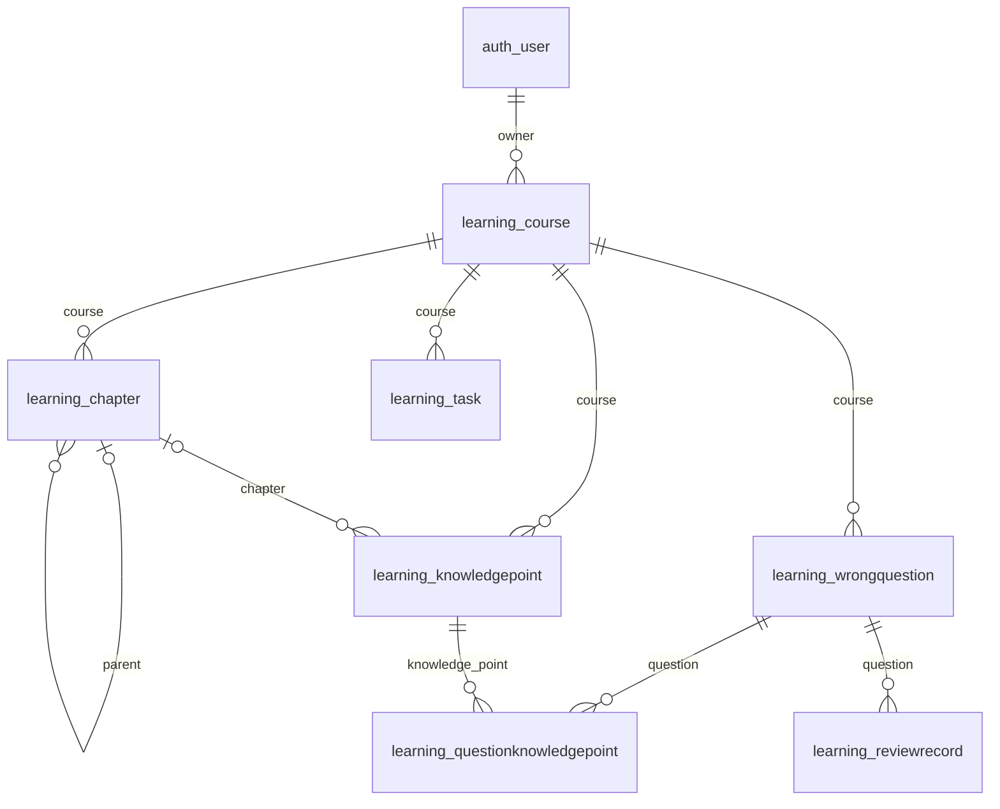
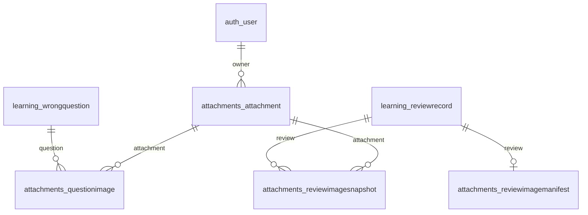
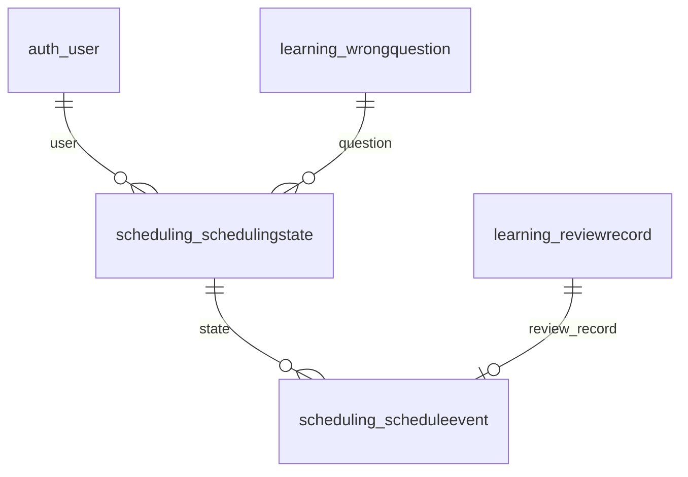
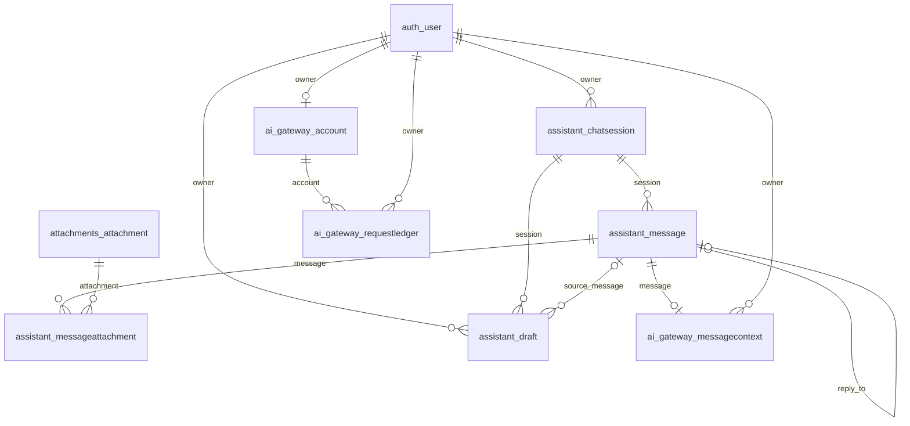
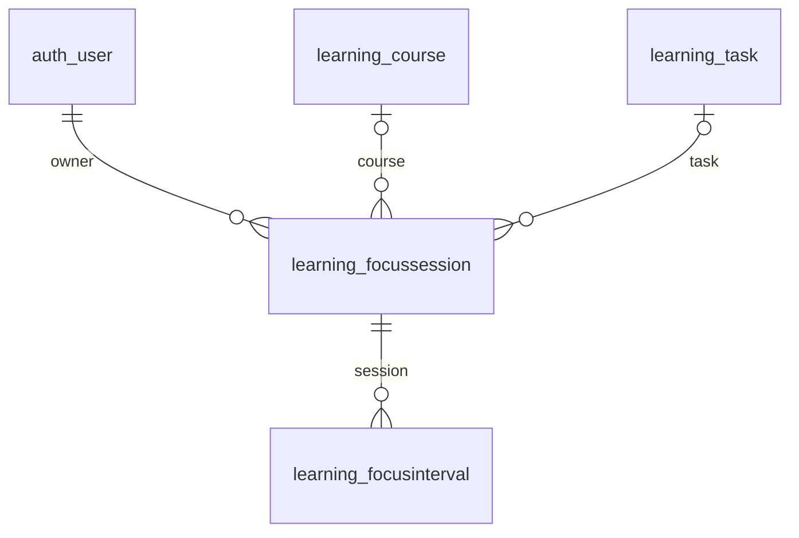

# 课程层级、产品体验与答辩验收

本轮目标是把已有数据关系变成可用的课程目录，把学习首页变成明确的行动入口。下列100分是内部验收参考，教师实际权重尚未确认，不代表教师评分或已获得100分。

## 100分验收标准

| 部分 | 分值 | 满分的可观察条件 | 本轮证据 / 仍需人工确认 |
|---|---:|---|---|
| 业务实体及需求覆盖 | 12 | 每张业务表能解释用途，不以重复表凑数 | 22业务表；模型字典、无数据结构SQL |
| 层级、一对多、多对多 | 12 | 展示课程→章→节→知识点，知识点关联错题及多次复习 | 课程目录；用户隔离、层级深度、归档及关联保护测试 |
| ER与真实数据库一致 | 10 | 主外键、可空关系、1:1与1:N正确 | 模型自动生成总图，下面四个分模块图；MySQL31表/44外键/24触发器 |
| 字典与设计理由 | 6 | 每个字段、索引与约束可解释 | 自动生成字典；章节使用邻接表，旧知识点允许待归类 |
| 视觉统一 | 10 | 四类主要页面字体、颜色、按钮、间距一致 | 保留暖白与绿色基调；课程工作台、新首页卡片；美观性需小组与教师判断 |
| 信息层次与下一步 | 10 | 首页能直接开始复习，课程内能找到任务/错题/统计 | 按待复习、未完成任务、全部完成分别给出下一步 |
| 图表与内容联动 | 8 | 先展示学习记录，能筛课程/日期/来源，图表口径明确 | 五段导航、课程学习概况；默认近30天；课程统计直达；知识点链接到关联错题 |
| 反馈、空状态与错误恢复 | 6 | 无内容有明确引导；错误输入可修正；删除不丢内容 | 未分类知识点保留；归档只读；有子节/知识点的章节拒绝删除 |
| 窗口与键盘适配 | 6 | 1440/1024/768/390无整页横溢；核心操作可用键盘 | 多尺寸真实浏览器检查、章节键盘展开、助手关闭焦点恢复；未声称全面无障碍认证 |
| 完整性和账号隔离 | 6 | 不能写其他用户/课程；DB直接非法写入也拒绝 | ORM/服务校验及24个MySQL触发器，含课程归属不可转移；独立测试库验证 |
| 事务和历史保护 | 5 | 失败整笔回滚，旧复习快照不被改写 | 现有历史保护回归；354条导入原记录的原字段核对不变 |
| 查询与索引 | 4 | 解释查询条件、复合索引和实际执行计划 | chapter_course_tree_idx；课程概况6次批量查询；本机只读EXPLAIN证据；不虚构大数据性能 |
| 可重复演示 | 3 | 账号、课程目录、图表、复习闭环可重复展示 | 隔离账号原生课程→任务→专注→错题→复习完整操作已验证；真实账号不写测试数据 |
| 交付一致性 | 2 | 源码/迁移/说明对应且有独立启动与回退说明 | 功能分支、增量迁移、隔离数据、原版保留；未发布新Release |

## 业务层级与兼容

`Chapter(course, parent, name, position)` 是章和节共用的邻接表。顶层章的 parent 为空；节的 parent 指向同课程的顶层章。最多两层目录，加上课程、知识点、错题和复习形成完整学习链路。限制深度让维护与答辩解释更直接，并避免任意深度树带来的循环及递归查询复杂度。

`KnowledgePoint.chapter` 可空且受保护。迁移0006不推断旧数据分类、不修改旧记录字段；未分类知识点仍显示在“待归类”。本机指定账号的分类是单独事务，不进入通用迁移或公开种子脚本。知识点在同一课程内改归属时，错题关联ID与旧复习快照不变。

写入仍遵循“锁课程→锁子对象”的顺序。服务层拒绝跨用户、跨课程、归档写入、循环和第三层；0007在MySQL追加4个触发器防止绕过表单后跨课程关联、移动课程或创建非法层级。非空章节不能删除；先移动知识点/子节，再删除空节点。

## 四个分模块ER视图

这些是同一真实模式的不同视图，不计作新增表。总体自动生成ER与全字段字典见 [数据库数据字典](数据库数据字典.md)。左侧 `|o` 表示子记录的外键允许为空，`||` 表示必选；右侧 `o|` 表示最多一条，`o{` 表示多条。

### 1. 学习核心与层级

### 2. 图片与不可变历史

### 3. 复习调度

### 4. 会话与预算

## 产品对照与本轮取舍

| 官方功能参考 | 本轮落地 | 边界 |
|---|---|---|
| [RemNote](https://help.remnote.com/en/articles/6022755-getting-started-with-spaced-repetition)：查看到期并进入复习队列 | 首页待复习数与“开始复习”直接入口 | 未实现其文档编辑、同步和完整卡片生态 |
| [Anki](https://docs.ankiweb.net/manual/studying)：先回忆、显示答案、自评及下次时间 | 保留现有独立作答→对照→自评→FSRS闭环，回归验证历史保护 | 现有三档自评不等同于Anki全部配置 |
| [MyStudyLife](https://mystudylife.com/tour/)：首页近期安排、课程与任务关联 | 课程工作台、任务搜索、今天/未来7天筛选 | 未新增考试、课表冲突、云提醒，以免扩大本次范围 |

这些是功能与交互参考，不代表已完成相同产品能力、全面竞品体验或教师评审。

## 五分钟演示顺序

1. 在专用答辩环境登录指定账号，确认侧栏账号，不注册新的演示账号。
2. 首页说明真实到期和逾期数量；历史日期保留原值。
3. 打开数据库课程，展开“关系数据库设计→规范化设计→函数依赖与范式”；点击有错题的知识点，展示多对多关联。
4. 搜索一项任务，切换今天/未来7天；空结果也能正确说明筛选条件。
5. 打开统计，展示近30天与课程筛选、自评及知识关联，说明教学曲线不等于个人实测。
6. 真正作答时进入复习流程，查看答案、选择自评并保存；只在确定要新增个人复习记录时提交。
7. 展示ER、外键、触发器与独立测试库中的拒绝用例；不要在答辩账号上运行破坏性SQL测试。

账号快照仅是本地副本，不会自动同步队友电脑。后续双机数据交换需要另行设计增量合并；不能重复覆盖整份快照。

## 专注与课程概况补充

当前真实结构为22业务表＋9框架表、44外键、24触发器。专注会话关联用户，可选关联课程与任务；有效区间属于会话，暂停不产生有效区间。参见 [章节复习与课程学习概况](21-章节复习与课程学习概况.md)，不要将专注分钟数解释为知识掌握度。

