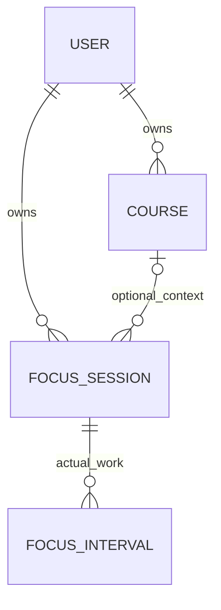

# 专注学习与第二轮验收

第二轮以课程层级优化版为起点，增加服务器持久化的专注计时。入口位于首页和主要导航。保持原有视觉系统，专注页取消悬浮助手，避免遮挡小窗口中的控件。

## 实体与关系

FocusSession 保存目标、状态、开始和保存时间。FocusInterval 保存每次开始或恢复到暂停或结束的有效区间。暂停时间没有区间，因此不会混入专注统计。今天的时长取有效区间与本地自然日的交集。单轮最多计入目标时长。

数据库新增 2 张表、3 条外键、2 个课程归属触发器；由生成列唯一索引保证每个账号最多一轮活动专注。服务层同时锁定账号行，使多标签页命令串行执行；重复开始、恢复、结束不会重复累计。业务表共22张，全部表31张，外键43条，触发器21个，已在答辩库实查。

## 使用与限制

- 15、25、45、60分钟倒计时；可关联当前账号的活跃课程，或选择自由专注。
- 页面打开时到时提交结束；页面关闭时不运行后台任务。返回后依据服务器时间恢复到时状态并完成保存，最多累计目标时长。
- 刷新、离开页面、休眠仍按经过时间计时。用户离开学习前应暂停。无法判定用户是否真的在学习。
- 今日统计包含正在进行的区间，每15秒向服务器同步；分钟向下取整，最近12次已结束记录显示到秒。
- 第三轮增加5分钟休息计时，可刷新恢复或提前结束，按账号保存在当前浏览器，不进入专注统计。尚无正计时、自动循环、声音通知和周趋势图。
- 备份必须使用包含新表的完整SQL。旧版v2.1数据包不应被视为包含新增专注记录。

## 验证

使用 `config.v2_integrated_test_settings` 运行 learning、attachments、assistant、scheduling、ai_gateway；339项通过（其中1项环境相关跳过）。桌面85项通过。新增8项覆盖暂停恢复、目标封顶、跨午夜、重复操作、归属隔离、归档课程、GET无写入、CSRF和数据库保护。前端在1440/1024/768/390宽度共8组页面检查，无水平溢出或JavaScript错误，时长切换通过。

完整源码、SQL、媒体和上一版素材保存在项目外 `baseline-round2-20261104`。SQL已恢复到独立验证库，原有业务表逐表内容哈希与当前库一致（系统迁移／权限元数据变化除外）。新表没有伪造演示记录。

项目外 `round2-evidence/对比说明.html` 可直接打开查看前后对比。所有修改未提交、未推送，原版未修改。

## 第三轮可靠性补充

实际HTTP与Edge浏览器在合成测试账号中验证：计时中与暂停中服务重启、刷新、提前结束、重复结束、多标签同步、断网重连、休息刷新恢复。另以真实MySQL并发连接验证同时开始/结束只产生一轮。学习模块127项通过，后续秒数展示专注11项通过。跨午夜与长时间经过为受控模拟；物理休眠、断电、长时间后台与原生EXE重启未实测。

新增只读状态接口，每15秒及页面/网络恢复时校准；自动结束使用complete命令，只有服务器确认达到目标才接受。图文证据在项目外round3-evidence/第三轮可靠性对比.html；其中流程截图是实际测试服务的合成账号，不是队友真实记录。
