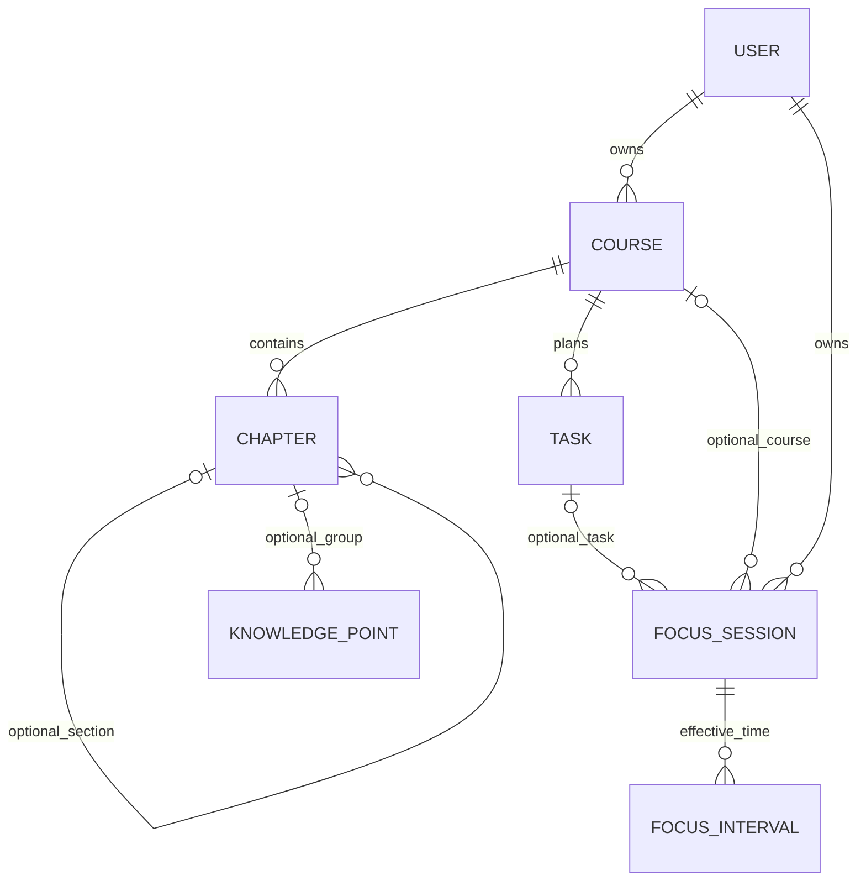

# 任务、专注与备份边界

课程页可直接进入该课程的专注准备页；未完成任务有明确“专注”入口。任务入口固定所属课程，开始后保存任务外键与当时标题。结束专注不会自动完成任务，因为投入时间不等于完成成果。已有活动轮次时保留原轮次，并明确告知未切换上下文。

## 为什么这样设计

- 专注轮次与有效区间分表，暂停不产生区间，支持恢复与跨日期统计，避免用一个总分钟数丢失事实。
- 任务外键可空，支持自由专注和只关联课程；数据库触发器要求关联任务属于同一课程，课程必须属于同一账号。
- `task_title` 是历史标题快照，属于有意保留的历史事实。任务后来改名不改历史；删除任务时外键置空，专注记录和原标题保留。
- 课程使用PROTECT，不能通过删除课程意外删除专注历史。
- 生成列唯一索引防止同一用户存在多个活动轮次；账号行锁使并发开始、暂停和结束串行处理。
- 本轮不增加表，增加1条外键、2个保护触发器。实查总计31表（22业务表）、44外键、23触发器。

## 导出不等于完整备份

专注页提供版本化JSON下载：`format=studyreview.focus`、`version=1`、`scope=focus_only`。包含当前账号全部专注轮次、有效区间、关联课程/任务参考、导出时间；不包含密码、其他用户记录、错题、复习、附件或聊天。活动区间尚未结束，离线读取时以exported_at作为截止并遵守目标封顶。

这是可读取的数据导出，不是导入包；当前没有提供覆盖现有账号的JSON导入按钮。旧v2.1账号ZIP格式没有新增专注字段，不能拿它回写新版数据库以冒充完整恢复。

完整恢复采用全部表SQL和媒体文件，源码/配置版本也需匹配。凭据保留原位，不复制到导出包。项目外`backup-after-round4-20261104`保存更新后的SQL和媒体；已恢复到独立验证库，31张表、44条外键、23个触发器一致，现有业务数据哈希无差异。基线`baseline-round4-20261104`也恢复验证，按原字段投影比较，无历史业务数据变化。不要直接将旧源码覆盖到已升级数据库；回退应在隔离位置整体恢复相匹配的基线。

## 已验证与限制

- 学习模块134项通过，包含真实HTTP/Edge浏览器“课程→任务→专注→结束→JSON下载”及并发测试。
- 已验证任务修改/删除后的历史保留、跨账号和归档边界、JSON格式、秒数、账号隔离及下载内容。
- 四个页面×四种宽度共16组无水平溢出或JS错误；任务上下文在1440×1000窗口可直接看到开始按钮。
- 桌面preflight相关17项通过，迁移漂移检查无遗漏。
- JSON导出不提供完整恢复能力。完整SQL验证使用当前实际数据库内容；有数据的任务专注关系和区间另外在合成账号测试中验证。没有声称物理休眠、断电或大规模数据性能已通过。
