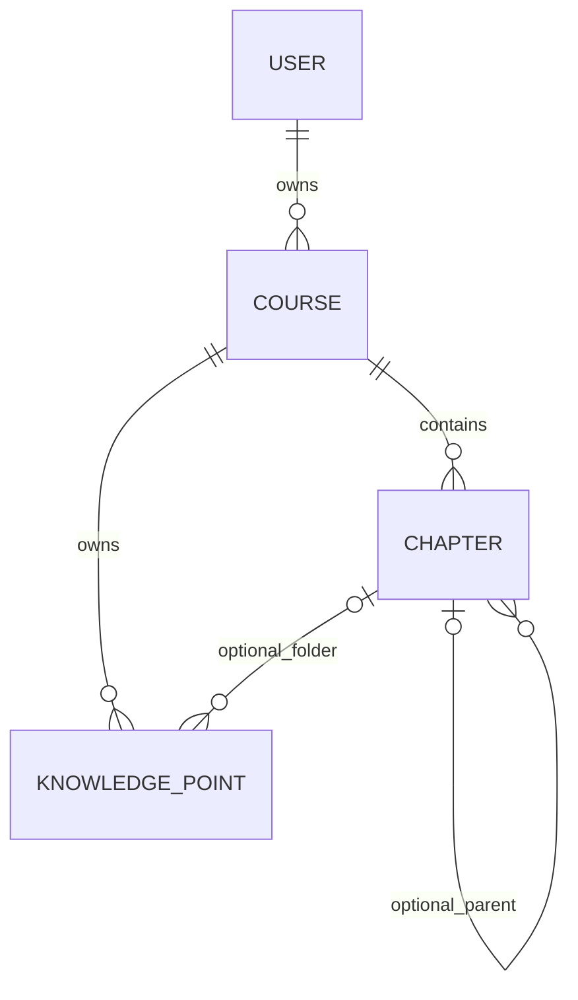
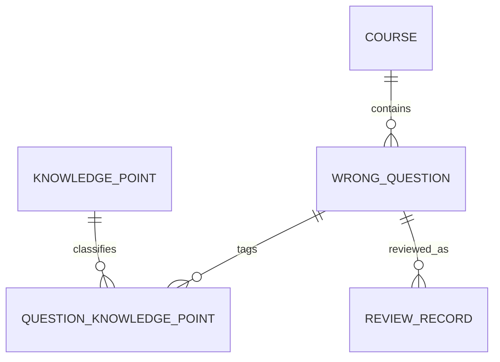
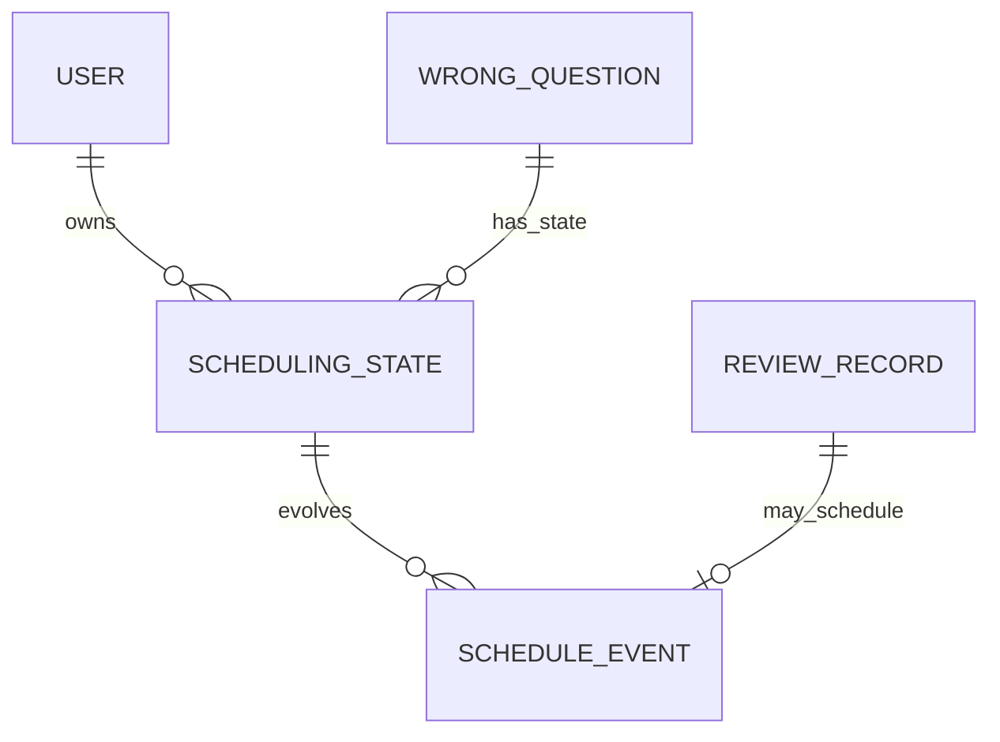
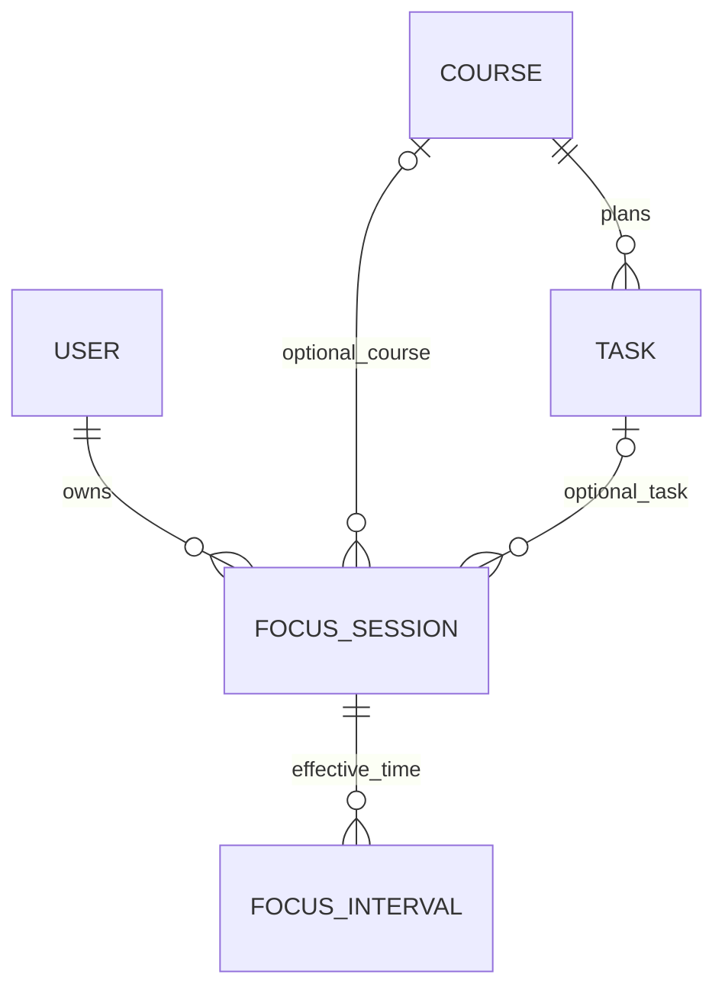

# 完整学习路径与答辩关系讲解

本材料解释实际业务关系与已验证行为，不以表或图的数量替代质量，也不承诺老师的最终分数。完整自动生成ER见《数据库数据字典》，以下按业务拆成可讲解的局部图。

## 一、课程目录：为什么采用自引用章节

章与节共用Chapter表：parent为空表示章，指向顶层章表示节；应用校验与数据库触发器共同限制两层，并阻止跨课程连接。KnowledgePoint仍直接关联Course，所以没有章节的旧知识点可以保留，再逐步归类。这是兼容旧数据的层级扩展，不是为了凑表数。

## 二、知识点到错题：为什么需要关联表

一道题可能涉及多个知识点，一个知识点也会出现在多道题中。中间表保存多对多关系，并用组合唯一约束防止重复关联；同课程保护阻止混用其他课程的知识点。复习记录保存当时题目、答案与知识点快照，后续题目修改不会改写旧历史。

## 三、复习调度：当前状态与历史事件分开

SchedulingState按user/question组合唯一，归属校验要求用户是题目主人。ScheduleEvent与ReviewRecord一对一，记录该次决策与版本；旧复习记录可能没有调度事件。历史不可任意改写，当前状态可更新。这样能解释“下次日期为何变化”，而不是只保存一个结果日期。

## 四、任务与专注：计划、投入和完成不是一回事

轮次下的有效区间承担暂停、恢复和跨午夜统计；计时不等于任务完成，也不等于知识掌握。任务删除后外键置空，历史标题保留。生成列唯一索引限制一个活动轮次，账号行锁防止并发重复开始。

## 用界面演示这些关系

1. 空账号首页以建课引导开始，不误报“今天已经完成”。
2. 创建课程、章、节、知识点，演示目录展开与键盘操作。
3. 创建任务，从任务直接进入带上下文的专注；结束后任务仍需自主确认完成。
4. 录入关联知识点的错题，选择今天复习。
5. 从首页到期入口进入：先写答案，再显示参考答案，选择自评保存；检查下次日期和历史。
6. 查看真实统计，说明历史筛选与自然日统计的不同口径；导出专注JSON时说明它不是完整备份。

上述流程已在真实HTTP服务与Edge中使用全新空测试账号完成；课程/任务/复习/专注路径、跳转主内容、Enter展开目录、Space自评和任务完成、390px页面及休息恢复均验收。错误状态通过重复课程名验证，输入框与错误/帮助文字的aria-describedby目标实际存在。

生产账号未写入这些示例。物理休眠、断电、长期后台、跨机完整账号包及大规模性能依然属于未完成验收，不应在答辩时声称已通过。
