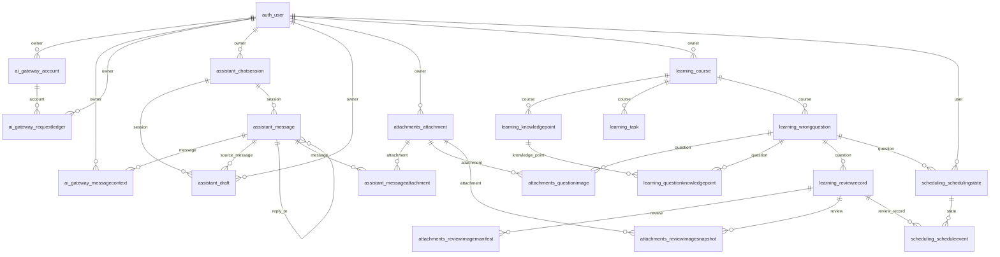

# 数据库数据字典

由当前 Django 5.2.17 模型元数据生成；共 19 张业务表。生成过程不读取安全配置、不连接 MySQL，也不读取真实记录。

数据库另有 Django 账户、权限、会话和迁移系统表。完整 SQL、触发器及数据库课程说明见 [04-数据库课程说明.md](04-数据库课程说明.md)。迁移文件是结构演进的执行依据，结构 SQL 供课程阅读。

下面的 ER 图展示业务表外键；auth_user 为 Django 用户表。

## ai_gateway_account

模型：ai_gateway.Account。account。

| 字段 | Django 类型 / 长度 | 空值 / 主键 / 唯一 | 外键及删除规则 | 默认 / 选项 |
|---|---|---|---|---|
| id | BigAutoField | NULL=False, PK=True, UNIQUE=True |  |  |
| owner | OneToOneField | NULL=False, PK=False, UNIQUE=True | auth_user.id / PROTECT |  |
| budget_cny | DecimalField / (14, 6) | NULL=False, PK=False, UNIQUE=False |  | 0 |
| spent_cny | DecimalField / (14, 6) | NULL=False, PK=False, UNIQUE=False |  | 0 |
| reserved_cny | DecimalField / (14, 6) | NULL=False, PK=False, UNIQUE=False |  | 0 |
| revision | PositiveBigIntegerField | NULL=False, PK=False, UNIQUE=False |  | 1 |
| key_reference | UUIDField / 32 | NULL=True, PK=False, UNIQUE=False |  |  |
| enabled | BooleanField | NULL=False, PK=False, UNIQUE=False |  | False |
| consent_at | DateTimeField | NULL=True, PK=False, UNIQUE=False |  |  |
| created_at | DateTimeField | NULL=False, PK=False, UNIQUE=False |  |  |
| updated_at | DateTimeField | NULL=False, PK=False, UNIQUE=False |  |  |

模型声明的约束：

- ai_account_amounts_nonnegative：CheckConstraint (AND: ('budget_cny__gte', 0), ('reserved_cny__gte', 0), ('spent_cny__gte', 0))
- ai_account_enabled_consent：CheckConstraint (OR: ('enabled', False), (AND: ('budget_cny__gt', 0), ('consent_at__isnull', False), ('key_reference__isnull', False)))

模型声明的索引：

无额外模型级索引；数据库自动为主键、唯一字段与外键建立相应索引。

## ai_gateway_messagecontext

模型：ai_gateway.MessageContext。message context。

| 字段 | Django 类型 / 长度 | 空值 / 主键 / 唯一 | 外键及删除规则 | 默认 / 选项 |
|---|---|---|---|---|
| message | OneToOneField | NULL=False, PK=True, UNIQUE=True | assistant_message.id / PROTECT |  |
| owner | ForeignKey | NULL=False, PK=False, UNIQUE=False | auth_user.id / PROTECT |  |
| selected_history_ids | JSONField | NULL=False, PK=False, UNIQUE=False |  | list |
| selected_target_snapshot | JSONField | NULL=False, PK=False, UNIQUE=False |  | dict |
| selected_course_snapshot | JSONField | NULL=False, PK=False, UNIQUE=False |  | dict |
| expected_version | TextField | NULL=False, PK=False, UNIQUE=False |  |  |
| created_at | DateTimeField | NULL=False, PK=False, UNIQUE=False |  |  |

模型声明的约束：

无额外模型级约束；主键、字段唯一性与外键仍生效。

模型声明的索引：

无额外模型级索引；数据库自动为主键、唯一字段与外键建立相应索引。

## ai_gateway_requestledger

模型：ai_gateway.RequestLedger。request ledger。

| 字段 | Django 类型 / 长度 | 空值 / 主键 / 唯一 | 外键及删除规则 | 默认 / 选项 |
|---|---|---|---|---|
| id | UUIDField / 32 | NULL=False, PK=True, UNIQUE=True |  | uuid4 |
| request_id | UUIDField / 32 | NULL=False, PK=False, UNIQUE=True |  |  |
| owner | ForeignKey | NULL=False, PK=False, UNIQUE=False | auth_user.id / PROTECT |  |
| account | ForeignKey | NULL=False, PK=False, UNIQUE=False | ai_gateway_account.id / PROTECT |  |
| request_hash | CharField / 64 | NULL=False, PK=False, UNIQUE=False |  |  |
| state | CharField / 9 | NULL=False, PK=False, UNIQUE=False |  | reserved；选项 [('reserved', '已预留'), ('succeeded', '已结算'), ('failed', '已失败'), ('uncertain', '结果或费用未确认')] |
| dispatched | BooleanField | NULL=False, PK=False, UNIQUE=False |  | False |
| dispatched_at | DateTimeField | NULL=True, PK=False, UNIQUE=False |  |  |
| pricing_snapshot | JSONField | NULL=False, PK=False, UNIQUE=False |  |  |
| input_token_ceiling | PositiveIntegerField | NULL=False, PK=False, UNIQUE=False |  |  |
| output_token_ceiling | PositiveIntegerField | NULL=False, PK=False, UNIQUE=False |  |  |
| reserved_cny | DecimalField / (14, 6) | NULL=False, PK=False, UNIQUE=False |  |  |
| held_cny | DecimalField / (14, 6) | NULL=False, PK=False, UNIQUE=False |  |  |
| estimated_cost_cny_peak | DecimalField / (14, 6) | NULL=True, PK=False, UNIQUE=False |  |  |
| usage | JSONField | NULL=True, PK=False, UNIQUE=False |  |  |
| failure_code | CharField / 60 | NULL=False, PK=False, UNIQUE=False |  |  |
| created_at | DateTimeField | NULL=False, PK=False, UNIQUE=False |  |  |
| updated_at | DateTimeField | NULL=False, PK=False, UNIQUE=False |  |  |
| settled_at | DateTimeField | NULL=True, PK=False, UNIQUE=False |  |  |

模型声明的约束：

- ai_ledger_state_valid：CheckConstraint (AND: ('state__in', ['reserved', 'succeeded', 'failed', 'uncertain']))
- ai_ledger_amounts_nonnegative：CheckConstraint (AND: ('held_cny__gte', 0), ('reserved_cny__gte', 0), (OR: ('estimated_cost_cny_peak__isnull', True), ('estimated_cost_cny_peak__gte', 0)))
- ai_ledger_dispatch_consistent：CheckConstraint (OR: (AND: ('dispatched', False), ('dispatched_at__isnull', True)), (AND: ('dispatched', True), ('dispatched_at__isnull', False)))

模型声明的索引：

- ai_ledger_owner_state_time：owner, state, created_at

## assistant_chatsession

模型：assistant.ChatSession。chat session。

| 字段 | Django 类型 / 长度 | 空值 / 主键 / 唯一 | 外键及删除规则 | 默认 / 选项 |
|---|---|---|---|---|
| id | UUIDField / 32 | NULL=False, PK=True, UNIQUE=True |  | uuid4 |
| owner | ForeignKey | NULL=False, PK=False, UNIQUE=False | auth_user.id / PROTECT |  |
| title | CharField / 120 | NULL=False, PK=False, UNIQUE=False |  | 新会话 |
| submission_key | UUIDField / 32 | NULL=False, PK=False, UNIQUE=True |  | uuid4 |
| created_at | DateTimeField | NULL=False, PK=False, UNIQUE=False |  |  |
| updated_at | DateTimeField | NULL=False, PK=False, UNIQUE=False |  |  |

模型声明的约束：

无额外模型级约束；主键、字段唯一性与外键仍生效。

模型声明的索引：

- assist_session_owner_time：owner, updated_at

## assistant_draft

模型：assistant.Draft。draft。

| 字段 | Django 类型 / 长度 | 空值 / 主键 / 唯一 | 外键及删除规则 | 默认 / 选项 |
|---|---|---|---|---|
| id | UUIDField / 32 | NULL=False, PK=True, UNIQUE=True |  | uuid4 |
| owner | ForeignKey | NULL=False, PK=False, UNIQUE=False | auth_user.id / PROTECT |  |
| session | ForeignKey | NULL=False, PK=False, UNIQUE=False | assistant_chatsession.id / PROTECT |  |
| source_message | ForeignKey | NULL=True, PK=False, UNIQUE=False | assistant_message.id / PROTECT |  |
| operation | CharField / 20 | NULL=False, PK=False, UNIQUE=False |  | ；选项 [('create_question', '新增错题'), ('update_question', '修改指定错题'), ('update_task', '修改指定任务')] |
| title | CharField / 180 | NULL=False, PK=False, UNIQUE=False |  |  |
| payload | JSONField | NULL=False, PK=False, UNIQUE=False |  |  |
| before_snapshot | JSONField | NULL=False, PK=False, UNIQUE=False |  | dict |
| after_snapshot | JSONField | NULL=False, PK=False, UNIQUE=False |  | dict |
| target_id | PositiveBigIntegerField | NULL=True, PK=False, UNIQUE=False |  |  |
| expected_version | TextField | NULL=False, PK=False, UNIQUE=False |  |  |
| submission_key | UUIDField / 32 | NULL=False, PK=False, UNIQUE=True |  | uuid4 |
| request_hash | CharField / 64 | NULL=False, PK=False, UNIQUE=False |  |  |
| status | CharField / 7 | NULL=False, PK=False, UNIQUE=False |  | pending；选项 [('pending', '待确认'), ('applied', '已确认保存')] |
| created_at | DateTimeField | NULL=False, PK=False, UNIQUE=False |  |  |
| expires_at | DateTimeField | NULL=False, PK=False, UNIQUE=False |  |  |
| applied_at | DateTimeField | NULL=True, PK=False, UNIQUE=False |  |  |
| applied_object_id | PositiveBigIntegerField | NULL=True, PK=False, UNIQUE=False |  |  |
| confirmation_key | UUIDField / 32 | NULL=True, PK=False, UNIQUE=True |  |  |

模型声明的约束：

- assist_draft_operation_valid：CheckConstraint (AND: ('operation__in', ['create_question', 'update_question', 'update_task']))
- assist_draft_application_valid：CheckConstraint (OR: (AND: ('applied_at__isnull', True), ('applied_object_id__isnull', True), ('confirmation_key__isnull', True), ('status', 'pending')), (AND: ('applied_at__isnull', False), ('applied_object_id__isnull', False), ('confirmation_key__isnull', False), ('status', 'applied')))

模型声明的索引：

- assist_draft_owner_status：owner, status, created_at

## assistant_message

模型：assistant.Message。message。

| 字段 | Django 类型 / 长度 | 空值 / 主键 / 唯一 | 外键及删除规则 | 默认 / 选项 |
|---|---|---|---|---|
| id | UUIDField / 32 | NULL=False, PK=True, UNIQUE=True |  | uuid4 |
| session | ForeignKey | NULL=False, PK=False, UNIQUE=False | assistant_chatsession.id / PROTECT |  |
| role | CharField / 9 | NULL=False, PK=False, UNIQUE=False |  | ；选项 [('user', '用户'), ('assistant', '助手'), ('system', '系统提示')] |
| text | TextField / 20000 | NULL=False, PK=False, UNIQUE=False |  |  |
| status | CharField / 16 | NULL=False, PK=False, UNIQUE=False |  | saved；选项 [('saved', '已本地保存'), ('processing', '等待处理'), ('completed', '已完成'), ('not_connected', 'AI 未连接'), ('provider_error', '处理失败')] |
| submission_key | UUIDField / 32 | NULL=False, PK=False, UNIQUE=True |  | uuid4 |
| request_hash | CharField / 64 | NULL=False, PK=False, UNIQUE=False |  |  |
| reply_to | OneToOneField | NULL=True, PK=False, UNIQUE=True | assistant_message.id / PROTECT |  |
| created_at | DateTimeField | NULL=False, PK=False, UNIQUE=False |  |  |

模型声明的约束：

- assist_message_role_valid：CheckConstraint (AND: ('role__in', ['user', 'assistant', 'system']))
- assist_message_status_valid：CheckConstraint (AND: ('status__in', ['saved', 'processing', 'completed', 'not_connected', 'provider_error']))

模型声明的索引：

- assist_message_session_time：session, created_at

## assistant_messageattachment

模型：assistant.MessageAttachment。message attachment。

| 字段 | Django 类型 / 长度 | 空值 / 主键 / 唯一 | 外键及删除规则 | 默认 / 选项 |
|---|---|---|---|---|
| id | BigAutoField | NULL=False, PK=True, UNIQUE=True |  |  |
| message | ForeignKey | NULL=False, PK=False, UNIQUE=False | assistant_message.id / PROTECT |  |
| attachment | ForeignKey | NULL=False, PK=False, UNIQUE=False | attachments_attachment.id / PROTECT |  |
| position | PositiveSmallIntegerField | NULL=False, PK=False, UNIQUE=False |  | 0 |

模型声明的约束：

- assist_message_attachment_uq：UniqueConstraint ['message', 'attachment']

模型声明的索引：

无额外模型级索引；数据库自动为主键、唯一字段与外键建立相应索引。

## attachments_attachment

模型：attachments.Attachment。attachment。

| 字段 | Django 类型 / 长度 | 空值 / 主键 / 唯一 | 外键及删除规则 | 默认 / 选项 |
|---|---|---|---|---|
| id | UUIDField / 32 | NULL=False, PK=True, UNIQUE=True |  | uuid4 |
| owner | ForeignKey | NULL=False, PK=False, UNIQUE=False | auth_user.id / PROTECT |  |
| display_name | CharField / 200 | NULL=False, PK=False, UNIQUE=False |  |  |
| width | PositiveIntegerField | NULL=False, PK=False, UNIQUE=False |  |  |
| height | PositiveIntegerField | NULL=False, PK=False, UNIQUE=False |  |  |
| sha256 | CharField / 64 | NULL=False, PK=False, UNIQUE=False |  |  |
| storage_key | CharField / 80 | NULL=False, PK=False, UNIQUE=True |  |  |
| byte_size | PositiveBigIntegerField | NULL=False, PK=False, UNIQUE=False |  |  |
| thumbnail_bytes | PositiveIntegerField | NULL=False, PK=False, UNIQUE=False |  |  |
| created_at | DateTimeField | NULL=False, PK=False, UNIQUE=False |  |  |

模型声明的约束：

- attachment_owner_sha_uq：UniqueConstraint ['owner', 'sha256']
- attachment_dimensions_valid：CheckConstraint (AND: ('height__gte', 1), ('height__lte', 10000), ('width__gte', 1), ('width__lte', 10000))

模型声明的索引：

- attachment_owner_time_idx：owner, created_at

## attachments_questionimage

模型：attachments.QuestionImage。question image。

| 字段 | Django 类型 / 长度 | 空值 / 主键 / 唯一 | 外键及删除规则 | 默认 / 选项 |
|---|---|---|---|---|
| id | BigAutoField | NULL=False, PK=True, UNIQUE=True |  |  |
| question | ForeignKey | NULL=False, PK=False, UNIQUE=False | learning_wrongquestion.id / PROTECT |  |
| attachment | ForeignKey | NULL=False, PK=False, UNIQUE=False | attachments_attachment.id / PROTECT |  |
| role | CharField / 16 | NULL=False, PK=False, UNIQUE=False |  | question；选项 [('question', '题干'), ('original_answer', '原答'), ('correct_answer', '参考答案'), ('error_reason', '错因')] |
| position | PositiveSmallIntegerField | NULL=False, PK=False, UNIQUE=False |  |  |

模型声明的约束：

- question_image_position_uq：UniqueConstraint ['question', 'role', 'position']
- question_image_attachment_uq：UniqueConstraint ['question', 'role', 'attachment']
- question_image_role_valid：CheckConstraint (AND: ('role__in', ['question', 'original_answer', 'correct_answer', 'error_reason']))

模型声明的索引：

无额外模型级索引；数据库自动为主键、唯一字段与外键建立相应索引。

## attachments_reviewimagemanifest

模型：attachments.ReviewImageManifest。review image manifest。

| 字段 | Django 类型 / 长度 | 空值 / 主键 / 唯一 | 外键及删除规则 | 默认 / 选项 |
|---|---|---|---|---|
| review | OneToOneField | NULL=False, PK=True, UNIQUE=True | learning_reviewrecord.id / PROTECT |  |
| image_count | PositiveSmallIntegerField | NULL=False, PK=False, UNIQUE=False |  |  |
| created_at | DateTimeField | NULL=False, PK=False, UNIQUE=False |  |  |

模型声明的约束：

无额外模型级约束；主键、字段唯一性与外键仍生效。

模型声明的索引：

无额外模型级索引；数据库自动为主键、唯一字段与外键建立相应索引。

## attachments_reviewimagesnapshot

模型：attachments.ReviewImageSnapshot。review image snapshot。

| 字段 | Django 类型 / 长度 | 空值 / 主键 / 唯一 | 外键及删除规则 | 默认 / 选项 |
|---|---|---|---|---|
| id | BigAutoField | NULL=False, PK=True, UNIQUE=True |  |  |
| review | ForeignKey | NULL=False, PK=False, UNIQUE=False | learning_reviewrecord.id / PROTECT |  |
| attachment | ForeignKey | NULL=False, PK=False, UNIQUE=False | attachments_attachment.id / PROTECT |  |
| role | CharField / 16 | NULL=False, PK=False, UNIQUE=False |  | ；选项 [('question', '题干'), ('original_answer', '原答'), ('correct_answer', '参考答案'), ('error_reason', '错因')] |
| position | PositiveSmallIntegerField | NULL=False, PK=False, UNIQUE=False |  |  |
| name_snapshot | CharField / 200 | NULL=False, PK=False, UNIQUE=False |  |  |
| width_snapshot | PositiveIntegerField | NULL=False, PK=False, UNIQUE=False |  |  |
| height_snapshot | PositiveIntegerField | NULL=False, PK=False, UNIQUE=False |  |  |
| sha256_snapshot | CharField / 64 | NULL=False, PK=False, UNIQUE=False |  |  |

模型声明的约束：

- review_image_position_uq：UniqueConstraint ['review', 'role', 'position']
- review_image_attachment_uq：UniqueConstraint ['review', 'role', 'attachment']
- review_image_role_valid：CheckConstraint (AND: ('role__in', ['question', 'original_answer', 'correct_answer', 'error_reason']))

模型声明的索引：

无额外模型级索引；数据库自动为主键、唯一字段与外键建立相应索引。

## learning_course

模型：learning.Course。course。

| 字段 | Django 类型 / 长度 | 空值 / 主键 / 唯一 | 外键及删除规则 | 默认 / 选项 |
|---|---|---|---|---|
| id | BigAutoField | NULL=False, PK=True, UNIQUE=True |  |  |
| owner | ForeignKey | NULL=False, PK=False, UNIQUE=False | auth_user.id / PROTECT |  |
| name | CharField / 120 | NULL=False, PK=False, UNIQUE=False |  |  |
| description | TextField | NULL=False, PK=False, UNIQUE=False |  |  |
| is_archived | BooleanField | NULL=False, PK=False, UNIQUE=False |  | False |
| created_at | DateTimeField | NULL=False, PK=False, UNIQUE=False |  |  |

模型声明的约束：

- course_owner_name_uq：UniqueConstraint ['owner', 'name']

模型声明的索引：

- course_owner_archive_idx：owner, is_archived

## learning_knowledgepoint

模型：learning.KnowledgePoint。knowledge point。

| 字段 | Django 类型 / 长度 | 空值 / 主键 / 唯一 | 外键及删除规则 | 默认 / 选项 |
|---|---|---|---|---|
| id | BigAutoField | NULL=False, PK=True, UNIQUE=True |  |  |
| course | ForeignKey | NULL=False, PK=False, UNIQUE=False | learning_course.id / PROTECT |  |
| name | CharField / 120 | NULL=False, PK=False, UNIQUE=False |  |  |

模型声明的约束：

- point_course_name_uq：UniqueConstraint ['course', 'name']

模型声明的索引：

无额外模型级索引；数据库自动为主键、唯一字段与外键建立相应索引。

## learning_questionknowledgepoint

模型：learning.QuestionKnowledgePoint。question knowledge point。

| 字段 | Django 类型 / 长度 | 空值 / 主键 / 唯一 | 外键及删除规则 | 默认 / 选项 |
|---|---|---|---|---|
| id | BigAutoField | NULL=False, PK=True, UNIQUE=True |  |  |
| question | ForeignKey | NULL=False, PK=False, UNIQUE=False | learning_wrongquestion.id / CASCADE |  |
| knowledge_point | ForeignKey | NULL=False, PK=False, UNIQUE=False | learning_knowledgepoint.id / PROTECT |  |

模型声明的约束：

- question_point_uq：UniqueConstraint ['question', 'knowledge_point']

模型声明的索引：

无额外模型级索引；数据库自动为主键、唯一字段与外键建立相应索引。

## learning_reviewrecord

模型：learning.ReviewRecord。review record。

| 字段 | Django 类型 / 长度 | 空值 / 主键 / 唯一 | 外键及删除规则 | 默认 / 选项 |
|---|---|---|---|---|
| id | BigAutoField | NULL=False, PK=True, UNIQUE=True |  |  |
| question | ForeignKey | NULL=False, PK=False, UNIQUE=False | learning_wrongquestion.id / PROTECT |  |
| reviewed_at | DateTimeField | NULL=False, PK=False, UNIQUE=False |  | now |
| review_date | DateField | NULL=False, PK=False, UNIQUE=False |  |  |
| answer | TextField / 20000 | NULL=False, PK=False, UNIQUE=False |  |  |
| rating | CharField / 5 | NULL=False, PK=False, UNIQUE=False |  | ；选项 [('again', '不会'), ('hard', '不熟'), ('good', '掌握')] |
| note | TextField / 5000 | NULL=False, PK=False, UNIQUE=False |  |  |
| next_review_date | DateField | NULL=False, PK=False, UNIQUE=False |  |  |
| title_snapshot | CharField / 180 | NULL=False, PK=False, UNIQUE=False |  |  |
| question_snapshot | TextField | NULL=False, PK=False, UNIQUE=False |  |  |
| original_answer_snapshot | TextField | NULL=False, PK=False, UNIQUE=False |  |  |
| correct_answer_snapshot | TextField | NULL=False, PK=False, UNIQUE=False |  |  |
| error_reason_snapshot | TextField | NULL=False, PK=False, UNIQUE=False |  |  |
| course_snapshot | CharField / 120 | NULL=False, PK=False, UNIQUE=False |  |  |
| knowledge_points_snapshot | JSONField | NULL=False, PK=False, UNIQUE=False |  | list |
| submission_key | UUIDField / 32 | NULL=False, PK=False, UNIQUE=True |  |  |

模型声明的约束：

- review_rating_valid：CheckConstraint (AND: ('rating__in', ['again', 'hard', 'good']))
- review_next_after_today：CheckConstraint (AND: ('next_review_date__gt', F(review_date)))

模型声明的索引：

- review_question_date_idx：question, review_date

## learning_task

模型：learning.Task。task。

| 字段 | Django 类型 / 长度 | 空值 / 主键 / 唯一 | 外键及删除规则 | 默认 / 选项 |
|---|---|---|---|---|
| id | BigAutoField | NULL=False, PK=True, UNIQUE=True |  |  |
| course | ForeignKey | NULL=False, PK=False, UNIQUE=False | learning_course.id / PROTECT |  |
| title | CharField / 180 | NULL=False, PK=False, UNIQUE=False |  |  |
| description | TextField | NULL=False, PK=False, UNIQUE=False |  |  |
| due_date | DateField | NULL=False, PK=False, UNIQUE=False |  |  |
| status | CharField / 4 | NULL=False, PK=False, UNIQUE=False |  | todo；选项 [('todo', '未完成'), ('done', '已完成')] |
| completed_at | DateTimeField | NULL=True, PK=False, UNIQUE=False |  |  |
| created_at | DateTimeField | NULL=False, PK=False, UNIQUE=False |  |  |
| creation_key | UUIDField / 32 | NULL=False, PK=False, UNIQUE=True |  | uuid4 |

模型声明的约束：

- task_completion_consistent：CheckConstraint (OR: (AND: ('completed_at__isnull', True), ('status', 'todo')), (AND: ('completed_at__isnull', False), ('status', 'done')))

模型声明的索引：

- task_course_status_due_idx：course, status, due_date

## learning_wrongquestion

模型：learning.WrongQuestion。wrong question。

| 字段 | Django 类型 / 长度 | 空值 / 主键 / 唯一 | 外键及删除规则 | 默认 / 选项 |
|---|---|---|---|---|
| id | BigAutoField | NULL=False, PK=True, UNIQUE=True |  |  |
| course | ForeignKey | NULL=False, PK=False, UNIQUE=False | learning_course.id / PROTECT |  |
| title | CharField / 180 | NULL=False, PK=False, UNIQUE=False |  |  |
| content | TextField / 20000 | NULL=False, PK=False, UNIQUE=False |  |  |
| original_answer | TextField / 20000 | NULL=False, PK=False, UNIQUE=False |  |  |
| correct_answer | TextField / 20000 | NULL=False, PK=False, UNIQUE=False |  |  |
| error_reason | TextField / 20000 | NULL=False, PK=False, UNIQUE=False |  |  |
| next_review_date | DateField | NULL=False, PK=False, UNIQUE=False |  |  |
| is_archived | BooleanField | NULL=False, PK=False, UNIQUE=False |  | False |
| created_at | DateTimeField | NULL=False, PK=False, UNIQUE=False |  |  |
| updated_at | DateTimeField | NULL=False, PK=False, UNIQUE=False |  |  |
| creation_key | UUIDField / 32 | NULL=False, PK=False, UNIQUE=True |  | uuid4 |

模型声明的约束：

无额外模型级约束；主键、字段唯一性与外键仍生效。

模型声明的索引：

- question_course_due_idx：course, is_archived, next_review_date

## scheduling_scheduleevent

模型：scheduling.ScheduleEvent。schedule event。

| 字段 | Django 类型 / 长度 | 空值 / 主键 / 唯一 | 外键及删除规则 | 默认 / 选项 |
|---|---|---|---|---|
| id | BigAutoField | NULL=False, PK=True, UNIQUE=True |  |  |
| state | ForeignKey | NULL=False, PK=False, UNIQUE=False | scheduling_schedulingstate.id / PROTECT |  |
| review_record | OneToOneField | NULL=False, PK=False, UNIQUE=True | learning_reviewrecord.id / PROTECT |  |
| algorithm | CharField / 16 | NULL=False, PK=False, UNIQUE=False |  |  |
| algorithm_version | CharField / 20 | NULL=False, PK=False, UNIQUE=False |  |  |
| config_version | CharField / 40 | NULL=False, PK=False, UNIQUE=False |  |  |
| config_snapshot | JSONField | NULL=False, PK=False, UNIQUE=False |  |  |
| state_revision_before | PositiveBigIntegerField | NULL=False, PK=False, UNIQUE=False |  |  |
| state_revision_after | PositiveBigIntegerField | NULL=False, PK=False, UNIQUE=False |  |  |
| before_state | JSONField | NULL=False, PK=False, UNIQUE=False |  |  |
| after_state | JSONField | NULL=False, PK=False, UNIQUE=False |  |  |
| fsrs_review_log | JSONField | NULL=False, PK=False, UNIQUE=False |  |  |
| reviewed_at | DateTimeField | NULL=False, PK=False, UNIQUE=False |  |  |
| review_date | DateField | NULL=False, PK=False, UNIQUE=False |  |  |
| due_utc | DateTimeField | NULL=False, PK=False, UNIQUE=False |  |  |
| suggested_date | DateField | NULL=False, PK=False, UNIQUE=False |  |  |
| applied_date | DateField | NULL=False, PK=False, UNIQUE=False |  |  |
| manual_override_date | DateField | NULL=True, PK=False, UNIQUE=False |  |  |
| created_at | DateTimeField | NULL=False, PK=False, UNIQUE=False |  |  |

模型声明的约束：

- schedule_revision_increments：CheckConstraint (AND: ('state_revision_after', <CombinedExpression: F(state_revision_before) + Value(1)>))
- schedule_due_after_review：CheckConstraint (AND: ('due_utc__gt', F(reviewed_at)))
- schedule_suggestion_future：CheckConstraint (AND: ('suggested_date__gt', F(review_date)))
- schedule_applied_future：CheckConstraint (AND: ('applied_date__gt', F(review_date)))
- schedule_override_consistent：CheckConstraint (OR: (AND: ('applied_date', F(suggested_date)), ('manual_override_date__isnull', True)), (AND: ('manual_override_date', F(applied_date)), ('manual_override_date__isnull', False)))

模型声明的索引：

- schedule_event_time_idx：state, reviewed_at

## scheduling_schedulingstate

模型：scheduling.SchedulingState。scheduling state。

| 字段 | Django 类型 / 长度 | 空值 / 主键 / 唯一 | 外键及删除规则 | 默认 / 选项 |
|---|---|---|---|---|
| id | BigAutoField | NULL=False, PK=True, UNIQUE=True |  |  |
| user | ForeignKey | NULL=False, PK=False, UNIQUE=False | auth_user.id / PROTECT |  |
| question | ForeignKey | NULL=False, PK=False, UNIQUE=False | learning_wrongquestion.id / PROTECT |  |
| algorithm | CharField / 16 | NULL=False, PK=False, UNIQUE=False |  | fsrs |
| algorithm_version | CharField / 20 | NULL=False, PK=False, UNIQUE=False |  | 6.3.2 |
| config_version | CharField / 40 | NULL=False, PK=False, UNIQUE=False |  | shanghai-daily-v1 |
| config_snapshot | JSONField | NULL=False, PK=False, UNIQUE=False |  |  |
| card_state | JSONField | NULL=False, PK=False, UNIQUE=False |  |  |
| revision | PositiveBigIntegerField | NULL=False, PK=False, UNIQUE=False |  | 0 |
| created_at | DateTimeField | NULL=False, PK=False, UNIQUE=False |  |  |
| updated_at | DateTimeField | NULL=False, PK=False, UNIQUE=False |  |  |

模型声明的约束：

- schedule_user_question_uq：UniqueConstraint ['user', 'question']

模型声明的索引：

无额外模型级索引；数据库自动为主键、唯一字段与外键建立相应索引。

